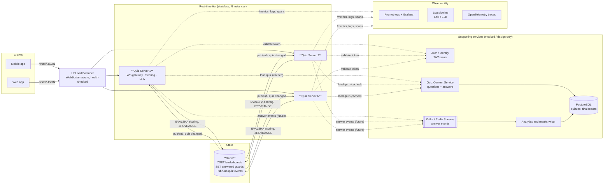
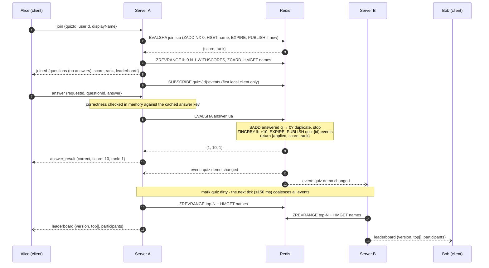

# Real-Time Vocabulary Quiz — System Design

## 1. Scope

This document covers the whole feature: users join a quiz by ID, answer questions, see their own score update immediately, and watch a live leaderboard. **Part 2 implements the real-time server** (the bold boxes below). Every other component is mocked or described only.

| Component | Status in this repo |
|---|---|
| Real-time quiz server (WebSocket gateway, scoring, leaderboard fan-out) | **Implemented** (`cmd/server`, `internal/*`) |
| Redis (state + pub/sub) | **Real**, via docker-compose |
| Question bank / quiz content service | Mocked: in-memory JSON fixtures behind `quiz.Repository` |
| Auth / identity | Mocked: `userId` is taken from the `join` message |
| Client apps | Simulated by `cmd/loadgen` (a CLI bot swarm) |
| Durable results store, analytics | Design only |

## 2. Architecture



## 3. Components

**Client apps (mobile/web).** They open one WebSocket per quiz session, send `join` and `answer` messages, and render `answer_result` and `leaderboard` messages. They reconnect with exponential backoff and jitter, then send `join` again. Because state lives on the server, a reconnect restores the score and the list of answered questions. In this repo, `cmd/loadgen` plays this role.

**Load balancer.** It terminates TLS and routes WebSocket upgrades to healthy instances using `/readyz`. **Sticky sessions are not needed**: any instance can serve any user in any quiz.

**Quiz server (implemented).** Stateless Go process with three internal parts:
- **WS gateway** (`internal/ws`): upgrades connections and caps inbound frame size. For each connection it runs:
  - a reader goroutine that processes messages in order, so each user's answers stay ordered
  - one writer goroutine draining a *bounded* send queue
  - a pinger that detects dead peers

  It also applies a per-connection token-bucket rate limit and maps domain errors to protocol error codes.
- **Scoring service** (`internal/scoring`): validates IDs and checks correctness **on the server**, since the answer key never reaches clients. It then applies the result atomically in Redis through a Lua script. Each `(user, question)` is scored exactly once, so retries and duplicate messages cannot inflate a score.
- **Hub** (`internal/hub`): tracks which quizzes have clients on *this* instance and subscribes only to those quizzes' Redis channels. It coalesces change events and broadcasts a top-N snapshot at most once per `BROADCAST_INTERVAL` (150 ms) per quiz. Each snapshot is encoded once and sent to every local client. A client whose queue is full is disconnected instead of being allowed to stall the hub.

**Redis (source of truth for live state).**
- `quiz:{id}:lb`: sorted set of userID → score. Leaderboard reads are `O(log N + k)`.
- `quiz:{id}:answered:{user}`: set of answered question IDs. This is the idempotency guard.
- `quiz:{id}:names`: hash of userID → display name.
- `quiz:{id}:events`: pub/sub channel. Its payload is only "something changed".
- The `{id}` hash tag puts all of a quiz's keys on one Redis Cluster slot, which is what lets a single Lua script touch several keys atomically.
- All keys have a TTL (24h by default) that is refreshed on every write, so abandoned quizzes clean themselves up.

**Quiz content service (mocked).** It owns quizzes, questions and answer keys. The server reads through the `quiz.Repository` interface, and quizzes are immutable during a session, so they cache perfectly in memory.

**Auth (mocked).** In production, the WebSocket upgrade request carries a JWT and the server takes `userId` from the verified claims instead of from `join`. The seam is `ws.Handler.ServeHTTP`.

**Answer event stream and results store (design only).** For durability, audit and analytics, each scored answer would also go to Kafka or a Redis Stream (the `XADD` can live inside the same Lua script, so it is atomic with scoring). A consumer writes final results to PostgreSQL once the quiz ends.

## 4. Data flow



Step by step:
1. **Join.** The server validates the IDs and loads the quiz. It then registers the user atomically: the user is added with 0 points only if new, so a re-join keeps the old score. It replies with the questions (without answers), the user's standing and a leaderboard snapshot. Only after that does it add the connection to the hub room, which guarantees `joined` is the first message the client sees.
2. **Answer.** The server checks correctness in memory. A single Lua script then marks the question as answered and, if the answer is correct, increments the score and publishes a change event. The user gets their new score and rank straight away in the ack. Median ack latency is about 0.3–0.5 ms locally.
3. **Propagation.** Every instance that has clients in that quiz receives the event and marks the quiz dirty. On the next tick, each such instance reads the top-N once and sends that same encoded message to all of its local clients.

## 5. Technologies and justification

| Concern | Choice | Why |
|---|---|---|
| Language | **Go** | Goroutines map naturally onto one reader and one writer per connection. Memory per connection is small (a few KB), so tens of thousands of connections per instance is realistic. That figure is an expectation; it was not measured here. Static binaries and a strong standard library (`net/http`, `log/slog`). |
| Transport | **WebSocket** (`github.com/coder/websocket`) | Full duplex and low overhead. It also supports clients sending answers on the same channel. SSE would need a second channel for answers, and polling is too slow and expensive. `coder/websocket` is small, context-aware, handles concurrent writes safely and includes ping/pong. |
| Live state + leaderboard | **Redis sorted sets** | Leaderboards are what sorted sets are built for: `ZINCRBY` is O(log N), and top-N and rank are O(log N + k). Lua scripts give multi-key atomicity without distributed locks. |
| Cross-instance fan-out | **Redis Pub/Sub** | It's already deployed and adds sub-millisecond latency. At-most-once delivery is acceptable because each broadcast is a *complete snapshot* and a periodic resync covers any gap. On Redis Cluster 7+, sharded pub/sub (`SSUBSCRIBE`/`SPUBLISH`) keeps pub/sub traffic from being broadcast to every node. |
| Metrics | **Prometheus** client | Industry standard and pull-based. Histograms give latency SLOs. |
| Logs | `log/slog` JSON | Structured and in the standard library. Every log carries `instance`, `quizId` and `userId`. |
| Tests | `go test -race`, **miniredis** | Fast hermetic tests. The same suite also runs against a real Redis (`make test-redis`), because miniredis's Lua engine differs from Redis's. |
| Packaging | Docker (distroless, nonroot) + docker-compose | Two instances plus Redis locally show horizontal scaling. The same image runs on Kubernetes. |
| Future: durable events | Kafka or Redis Streams | Replayable log for results, analytics and anti-cheat, without adding work to the hot path. |
| Future: quiz content | PostgreSQL + a content service | Relational data that is edited rarely and cached heavily by the real-time tier. |

## 6. Scalability

**Horizontal scaling.** Server instances hold no quiz state; they only hold connections. Adding instances adds connection capacity linearly, and any instance can serve any user.

**Cost per answer.** One Lua call (O(log N)) and one small `PUBLISH`, independent of how many people are watching.

**Cost per broadcast.** Broadcasts are throttled per quiz *per instance*. A quiz with `A` answers/s spread over `I` instances causes at most `I × (1 / 0.15 s)` top-N reads per second, whatever `A` is. For example, 10,000 answers/s on 10 instances is still at most 67 reads/s for that quiz, with a single JSON encode per read.

**Hot quizzes (100k+ participants in one quiz).**
- Only the top-N goes to everyone. Each user's own rank arrives in their `answer_result`, so broadcasts are O(N_top), not O(participants).
- One quiz lives on one Redis shard, so it is bounded by one Redis primary (roughly 100k+ simple ops/s). Beyond that:
  1. Batch score increments at the instance level. This trades per-answer atomic rank for throughput.
  2. Shard the leaderboard into `lb:0..k` and merge the top-N at read time.
  3. Put read replicas behind the leaderboard reads.
- `BROADCAST_INTERVAL` can be adaptive: longer for huge quizzes, shorter for small ones.

**Many quizzes.** Redis Cluster shards by quiz via the hash tag. Each instance subscribes only to the quizzes it has clients for.

**Connection limits.** In front of this sit OS file descriptors (tune `ulimit`), the load balancer's connection limits and memory. Each connection holds about two goroutines plus a send buffer of at most 64 messages.

**Trade-offs made:**

| Trade-off | Gain | Cost |
|---|---|---|
| Leaderboard throttled to ≤150 ms | Broadcast cost is bounded under any answer rate | Up to ~150 ms extra staleness. The user's own score is still instant via the ack. |
| Pub/sub (at-most-once) instead of streams | Simple, sub-ms, no consumer state | A lost event delays one update until the next event or the 5 s resync |
| Top-N broadcasts only | O(N_top) fan-out payload | Clients don't see every participant. The full list would be a paginated fetch (future). |
| First submission per question is final | Simple, exactly-once, easy to test | No "change your answer" feature |
| Redis as live source of truth, no DB on the hot path | Sub-ms scoring | Durability depends on Redis persistence (AOF) plus the future event stream |
| Slow clients are disconnected | One bad network can't degrade a room | That client has to reconnect (automatic, and state is preserved) |

## 7. Performance

Measured locally on an Apple Silicon laptop with two server processes, Redis 8.2 and the loadgen on the same machine. 1000 users each answered 10 questions:

```
answers acked:       10000 (1242/s), 0 errors
answer ack latency:           p50=270µs p95=1.48ms p99=7.67ms
answer→leaderboard latency:   p50=79ms  p95=147ms  p99=154ms   (includes the 150 ms throttle)
consistency check: OK
```

How the hot path is kept cheap:
- One Redis round trip per answer. The rank is computed inside the scoring script.
- The answer key is checked in memory.
- Each leaderboard snapshot is marshalled once per instance per tick, not once per client.
- The pub/sub receive loop does no I/O; it only sets dirty flags.
- Leaderboard reads use a pipeline, and concurrent flushes are bounded (32).

## 8. Reliability

| Failure | Behaviour |
|---|---|
| Duplicate or retried answer (network retry, reconnect) | The `SADD` guard makes it a no-op. The ack reports `alreadyAnswered` along with the true score. Covered by tests with 100 concurrent duplicates. |
| Server instance crash or deploy | On `SIGTERM`: stop accepting, send `1001 GoingAway` to clients, drain. Clients reconnect to another instance and `join` again, and their score is preserved. Verified manually by killing an instance mid-loadgen: 150 users reconnected with 0 errors. |
| Slow or stalled client | Its bounded send queue fills, it is disconnected (metric `quiz_dropped_slow_clients_total`), and other clients are unaffected. |
| Dead peer (lost mobile signal) | Pings every 20 s. When a ping fails, the server closes the connection and leaves the room. |
| Redis briefly unavailable | Requests get a retryable `internal` error, and `/readyz` fails so the load balancer drains the instance. go-redis reconnects and re-subscribes. The periodic resync (5 s) repairs any missed broadcasts. |
| Pub/sub message lost | The next event or resync delivers a complete, newer snapshot. |
| Malformed or abusive input | 4 KB frame limit, a JSON validation error, ID whitelisting (which also prevents Redis key injection), per-connection rate limiting (20 msg/s, burst 40). |
| Redis data loss | Mitigated in production with AOF `everysec` plus replicas (Sentinel or a managed Redis), and with the answer event stream as a replayable record. |

## 9. Maintainability

- Packages follow single responsibilities: `quiz` (content), `scoring` (all writes), `leaderboard` (reads), `hub` (fan-out), `ws` (transport), `protocol` (wire types shared with the loadgen), `keys` (the Redis schema in one place), `server` (wiring).
- Dependencies are injected. The hub depends on small interfaces (`Client`, `Snapshotter`), so it is tested with fakes.
- The configuration is 12-factor (environment variables) and validated at startup.
- A single `make test` runs unit, concurrency and multi-instance integration tests under the race detector.

## 10. Monitoring and observability

**Metrics** (`/metrics`, per instance):

| Metric | Use |
|---|---|
| `quiz_ws_connections`, `quiz_active_quizzes` | Capacity, load-balancer balance, autoscaling signal |
| `quiz_messages_in_total{type}`, `quiz_messages_out_total{type}` | Traffic mix; spotting abuse (`invalid`, `unknown`) |
| `quiz_answers_total{result}` | Correct / incorrect / duplicate / error rates. A duplicate spike points to client retry storms. |
| `quiz_answer_duration_seconds` | Scoring latency SLO (e.g. p99 < 50 ms) |
| `quiz_broadcast_duration_seconds` | Fan-out cost per snapshot |
| `quiz_redis_errors_total{op}` | Dependency health |
| `quiz_dropped_slow_clients_total` | Client network quality, send buffer sizing |
| Go runtime and process collectors | Goroutines (leak detection), GC, memory, file descriptors |

**Logs.** Structured JSON with `instance`, `quizId` and `userId` on each connection. Only unexpected errors are logged at `error` level; client mistakes are counted in metrics rather than logged.

**Suggested alerts:**
- answer p99 > 50 ms for 5 minutes
- Redis error rate > 1%
- `/readyz` failing
- dropped-client rate climbing
- connections per instance > 80% of capacity

**Tracing (next step).** OpenTelemetry spans for `join` and `answer` with Redis child spans. Trace context would propagate into the answer event stream so that a single answer can be followed end to end.

**Dashboards.** Connections and quizzes per instance, answer rate and latency heatmap, broadcast rate and duration, and error and drop rates.

## 11. Security notes

- Answer keys never leave the server, and scoring happens only on the server.
- Auth is mocked here. In production: validate a JWT during the upgrade, bind `userId` from the claims, and restrict `OriginPatterns`.
- Input is bounded (frame size, ID pattern, name length) and rate-limited per connection.

## 12. Future work

- A host-driven, timed mode with speed bonuses: a per-quiz state machine owned by a single leader, with timers kept in Redis.
- The answer event stream plus a final results writer to PostgreSQL.
- A paginated "full leaderboard" and a "players around me" view (`ZREVRANK` ± k).
- Sharded pub/sub on Redis Cluster, and adaptive broadcast intervals.

## 13. AI collaboration in design

The design was built with **Claude Code (Claude Opus 5.5)** as a design partner, working from `requirements.md`:

1. **Requirements analysis.** Claude summarised the brief and pointed out what would be graded implicitly: exactly-once scoring, horizontal fan-out, and the weight given to verification evidence.
2. **Decision interview.** Claude did not assume the key forks; it asked me about them and I chose each one:
   - which component to build (server)
   - which language (Go)
   - whether to use real Redis or in-memory state (Redis)
   - the quiz flow (self-paced)
   - the scoring rule (fixed points, first submission counts)
   - which demo client (CLI load generator)
3. **Architecture proposal.** Claude proposed the Redis sorted set with a Lua idempotency guard, and pub/sub with per-instance coalesced broadcasts. I reviewed the trade-offs (throttle staleness versus fan-out cost, at-most-once pub/sub) and accepted them because snapshots are self-healing.
4. **How the design was checked.** Each design claim is backed by a test or a measurement rather than taken on trust:
   - exactly-once: concurrent duplicate tests
   - cross-instance propagation: the two-instance integration test
   - failover: killing an instance mid-run
   - latency: loadgen percentiles

   Details are in [`ai-collaboration.md`](ai-collaboration.md).
